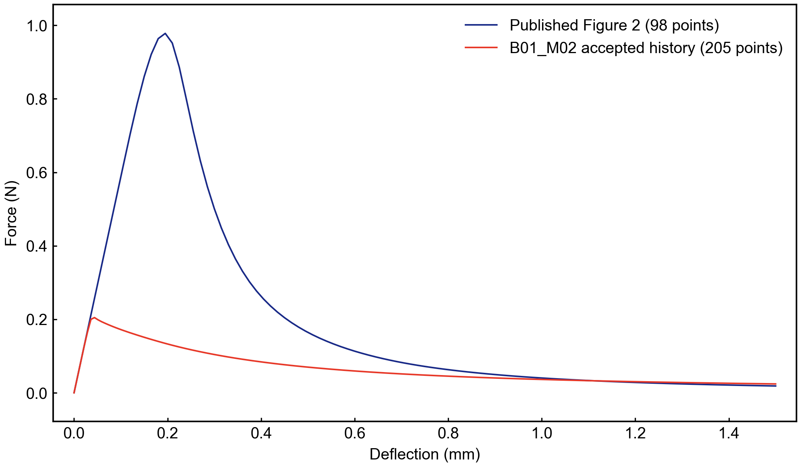
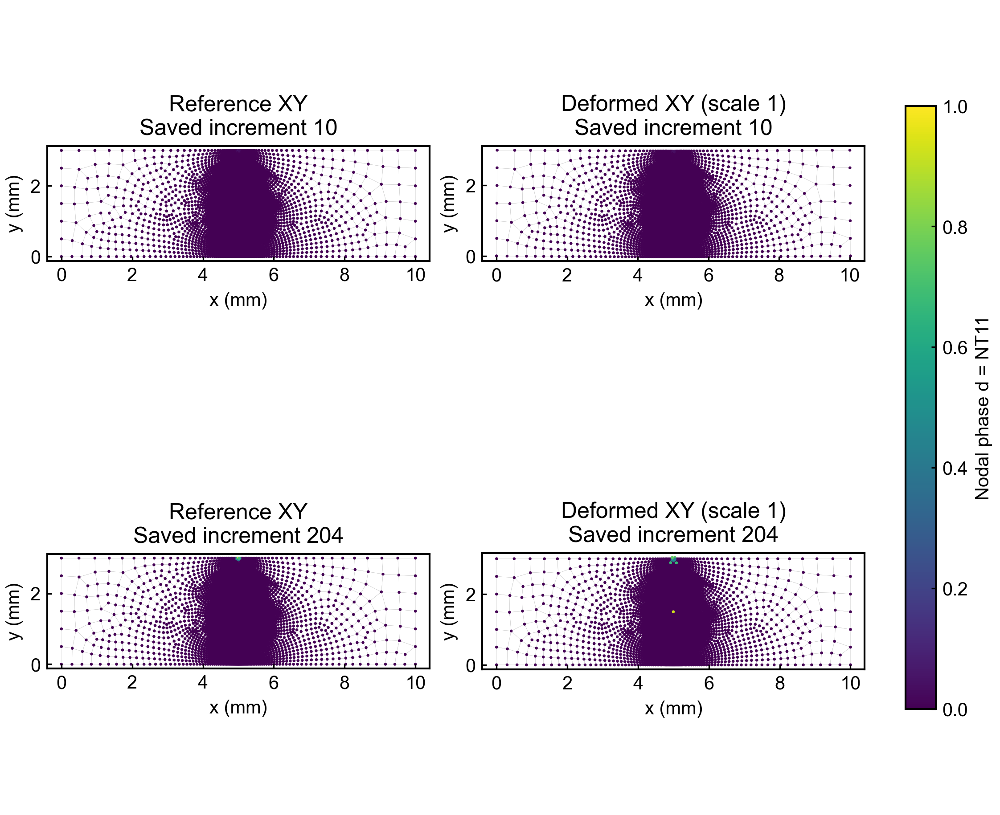

# ITO 释放诱导相场断裂：当前结果与 Pro 裁定包40

项目 ITO_PRECONDITIONING_LOCAL_MECHANICS / ITO-LOCAL-01；唯一工作包 ITO_RELEASE_FRACTURE_PHASEFIELD_V1。
执行端真实 thread_id：01a0d157-8547-7552-bb05-9a1c1c92698d。
固定物理方案：[3a906ee46ddd731b8e3c59073341862de1838615](https://github.com/youyangzhou574-eng/ITO-LOCAL-01-preconditioning-mechanics/tree/3a906ee46ddd731b8e3c59073341862de1838615/plans/ITO_RELEASE_FRACTURE_PHASEFIELD_V1)。

## 最新人类授权

> 我说过了不用设置额度 你把这话也转给pro以完成为目标 只要方向不偏就不要额度 你把现在的结果上传到github然后申请pro裁定

已取消固定次数上限，保留真实用量记账。原 analysis32/P1=8/DC48 及“最后1次仅修复”限制已经失效，不再等待 A/B 选择。当前实际使用 analysis7、P1=7、DC8、readonly8。此授权以完成固定工作包为目标，不改变材料/厚度、边界、seed、接触、相场物理或科学验收标准。后续每项计算仍需明确验证问题、新源绑定和实际资源检查。

## 当前结论

| 项目 | 实际状态 |
|---|---|
| P0 | 编译/接口骨架闭合；生产 AT2/Hencky solid-shell UEL 尚未实现，XIT 骨架不能作生产 |
| P1 / B01_M02 | native15905136 完成，204 accepted / 0 rejected；科学不通过 |
| 峰值 | 0.20462124049663544 N，对照数字化峰值0.97812691074729 N；误差79.0802974%，固定5%门 FAIL |
| 几何 | 首次观测非正角点在保存增量10，该帧Gauss仍正；全集409个非正几何探针样本 |
| 相场 | 47913个越界及60864个下降节点-帧样本；初帧微负约-1.416e-18，原幅值保留 |
| 历史H | 保存态非负且无下降；未证明全部trial及回滚 |
| 能量 | UNRESOLVED；作者SSE未初始化，RF/U梯形功仅估计 |
| P1有效前缀 | null；峰值在inc9，没有对应保存场，不能补场或推定峰前几何合格 |
| P2/P3 | 未准入 |
| 当前仿真 | 无active/native/readonlyjob |
| 探针39 | 离线构建完成，29测试GREEN、一次review问题已修复；Fortran未compile、无DC/analysis |

原生成功退出不等于科学通过。这是作者 PF-CZM 指数软化、CPE4T 平面应变程序基准，不能当作正式三维ITO/PDMS AT2结果。原始B01误差75.0847%FAIL也保留。

## 真实图和数据

图均为已交付30的原字节副本，不重新计算或重绘；原视觉回执随包提供。节点散点与变形边线不是生产裂缝或实体壳结果。

- [力-挠度CSV](data/audit30/curve30.csv)、[全部历史CSV](data/audit30/history30.csv)、[真实帧清单](data/audit30/frames30.csv)、[相场/几何极值](data/audit30/extrema30.csv)。
- [原科学交付报告30](reports/B01_M02_SCIENTIFIC_DELIVERY_REPORT30.md)、[审计数值结果30](data/audit30/RESULT30.json)。
- 报告原件里的本地路径和旧额度是历史记录；本README中的相对图/CSV链接及最新授权用于本次审阅。

## 已完成的接口定位及边界

31全5820元素/5908节点装配72个标量候选，只报告22局部节点，并非6元素截断。32的标准Gauss法向应变差异由33二维Bbar面内平均体积应变解释；不能据此证明native错误。34局部完整star力残差很小；35定位到inc10最后equilibrium46；36补齐5904完整star后，DOF2 fint-RF=-3.521977704756818e-6 N，传播存储区间后的幅值与MSG +3.524e-6相交，原始符号相反保留未资格。机械最大节点扩展路线已闭合。

37/37A只排除所核同phi/H下q=-RPL、q_phi=-DRPLDT的简单常数/符号转写差异。实际UMAT phi=TEMP+DTEMP，保存H不能确认最后热组装回调H；SEPARATED不等于UMAT kflagS1。弱标量残量量纲mm，不能直接当N或物理耗散热。38有界来源未取得2021运行规则；2025文档不替代2021实际CPE4T温度取样/RPL积分/真实NPT空间资格。

[35原生收敛报告](reports/B01_M02_NATIVE_CONVERGENCE_DELIVERY_REPORT35.md) · [36完整star报告](reports/B01_M02_MAXIMUM_STAR_DELIVERY_REPORT36.md) · [37A修正版来源报告](reports/B01_M02_SCALAR_CONVENTION_REPORT37A_CORRECTED.md) · [38有界来源路线](reports/B01_M02_COUPLED_SOURCE_ROUTE_REPORT38.md)。对应原生摘录、完整star装配表和RESULT在data/中。

## 探针39：可审阅的下一项 SUGGESTION

[实现设计](docs/B01_M02_PROBE_IMPLEMENTED_DESIGN39.md) · [输入](probe39/PROBE39.inp) · [UMAT](probe39/PROBE39_umat.for) · [独立矩阵预测](probe39/EXPECTED39.json) · [实现与测试源文件](probe39/sources)。

两个不连接的CPE4T分别为单位方形和原5817参考几何，8个稳态步骤：S1-S4按实际NPT基施加RPL=1；T1-T4为无源节点温度基。theta采用1基线，NT/RFL同表防止零行消失。每元仅localnode3 U1自由，E100/nu0/k1/厚度1/无膨胀。STATEV为接受态TEMP/DTEMP/COORDS/RPL快照，不观察全trial与回滚。原始RFL符号与NPT标签保留，不拟合倍率或翻号。

最终29离线测试通过；一次review C0/I1/M0发现的geometry绑定缺陷已真实RED-GREEN修复，凭据绑定完整geometry。原始review、反例RED日志和最终GREEN日志保留。没有重跑已闭合测试或进行第二次review。native_pass=false，原生ABI、RFL打印、真实DAT表头及接受态关联仍须验证；目前不存在原生dispatch。此探针即使通过，也只资格有限接口，不能直接宣告M02根因或P1 PASS。

## 请求 Pro 裁定

1. 确认将最新人类“方向不偏、以完成为目标、无固定次数额度”落实到后续执行；不重新施加32/8/48或最后一次用途限制。
2. 依据本包实际FAIL及已闭合路线，裁定是否先执行probe39取得2021温度/RPL/NPT运行证据。若认可，请给出可区分的预期观测、必要真实输出及对后续P1修复的使用边界；若信息不足，请提出更直接的最小技术路线。
3. 明确P1应如何闭合：哪些现有失败来自尚未资格的接口/模型假设，下一项应验证什么，什么证据才能准入P2。材料/厚度不能调到命中峰值，不把成功退出或微小损伤当裂纹资格，不放宽科学门。
4. 后续原生由NEW source-bound dispatch/admission、必要测试与一次独立review、相邻资源检查和submission intent落实。取消次数额度后保留真实记账，避免无信息增益重复算例。请针对本project/client/package给出明确decision_id及技术路径。

## 文件与取证

MANIFEST40.json列出上传成员的SHA256、Git blob SHA、字节数及相对来源；同一buffer计算SHA后解码/复制。只发布限定报告、图、CSV、输入、探针源码和对应回执，没有重新打开ODB或运行历史入口，没有上传凭据、服务器账户配置或大型原生数据库。历史报告/闭合凭据按原字节保留，最新授权另行追加。
