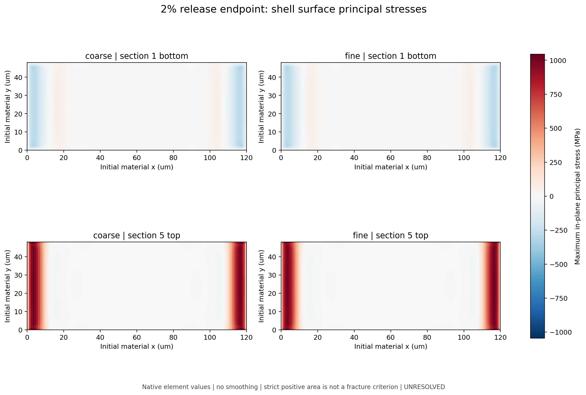
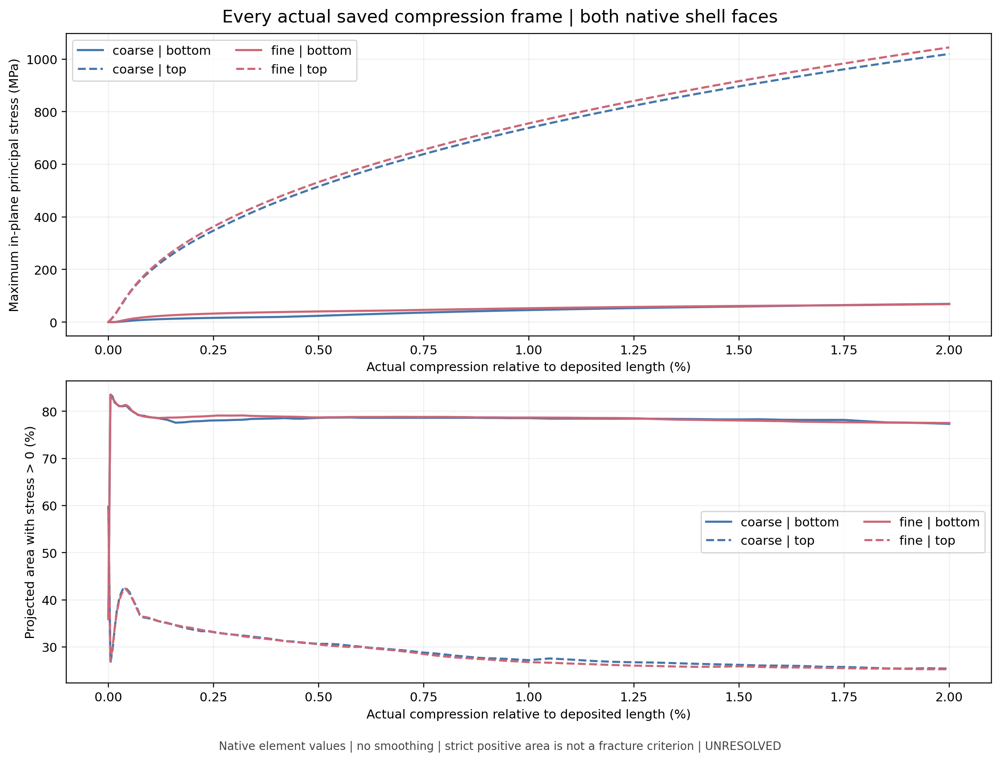

# ITO 上下表面应力证据审阅

以下为已关闭诊断19交付物的选定证据。本次上传沿用其原图与 CSV 字节，不重跑求解、ODB 提取或本地分析。依据和摘要见 SURFACE_STRESS_PROVENANCE.json。

## 2 percent 约束回缩端点

端部长度由 132 um 减至 129.36 um，相对初始 120 um 仍有 7.8% 伸长，底部支撑保持。这不是 Pro 新方案中的完全释放。

| 量 | 粗网格 1 um | 细网格 0.5 um |
|---|---:|---:|
| 上表面最大面内主应力 MPa | 1019.5995 | 1044.4679 |
| 上表面主应力正值投影面积比例 | 25.4167% | 25.2821% |
| 下表面最大面内主应力 MPa | 69.3906 | 68.3547 |

上表面峰值差约 2.439%（粗网格作分母）；峰值位置发生变化。强上表面拉应力主要在 x 端部带。正值面积表示应力大于零，不表示超过断裂强度的面积。

图中 release endpoint 是保留底部支撑、端部位移给定的 2% 回缩。色标统一，较弱的下表面拉应力颜色较浅。原图未重新渲染。

## 全部保存帧

原诊断覆盖每个网格的膜出生及压缩阶段全部 85 帧、共 170 组原生 S 数据，使用实际 S11/S22/S12 计算面内主应力。下图和 [CSV](ALL_SAVED_SURFACE_STRESS19.csv)来自该已完成诊断。

出生残差约为 1e-6 MPa；此时严格正值面积对零附近噪声敏感，不能作为开裂事件。矢量原图：[表面图 SVG](01_NATIVE_SURFACE_MAPS19.svg)、[演化图 SVG](02_ALL_SAVED_SURFACE_EVOLUTION19.svg)。

## 解释范围

- SF1/STH 是特定局部方向的截面平均量，不能代表上下表面的最大拉应力。同一单元上下表面拉压反转与明显弯曲贡献一致，尚不确定唯一机制。
- 原生 section number 1/5、IP1 身份完整；上下表面解释结合实际五点 Simpson 壳截面与公开 2025 约定，实际求解为 2021，导出缺少 section description 和局部方向基底。这些限制保留。
- 没有补齐缺失的横向应力分量，也没有给出完整三维主应力或全局裂纹方向。
- 既有模型没有断裂或脱粘机制，不能从峰值直接宣告开裂。两个网格相近也不证明全局收敛。

科学状态保持 `UNRESOLVED / scientific_pass=false / validprefix=null`。请审阅上述表述是否足够，以及深度筛查之后还需要哪些与结论直接相关的证据。
